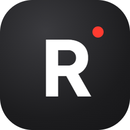
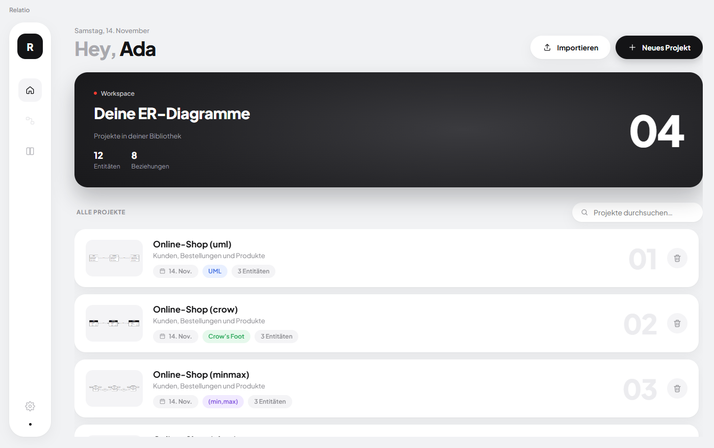
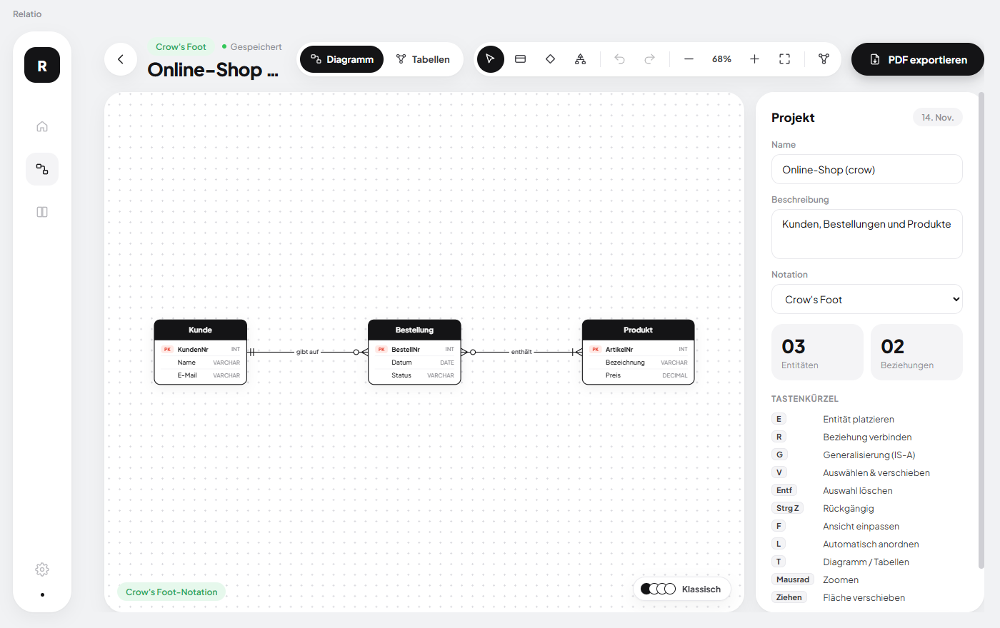
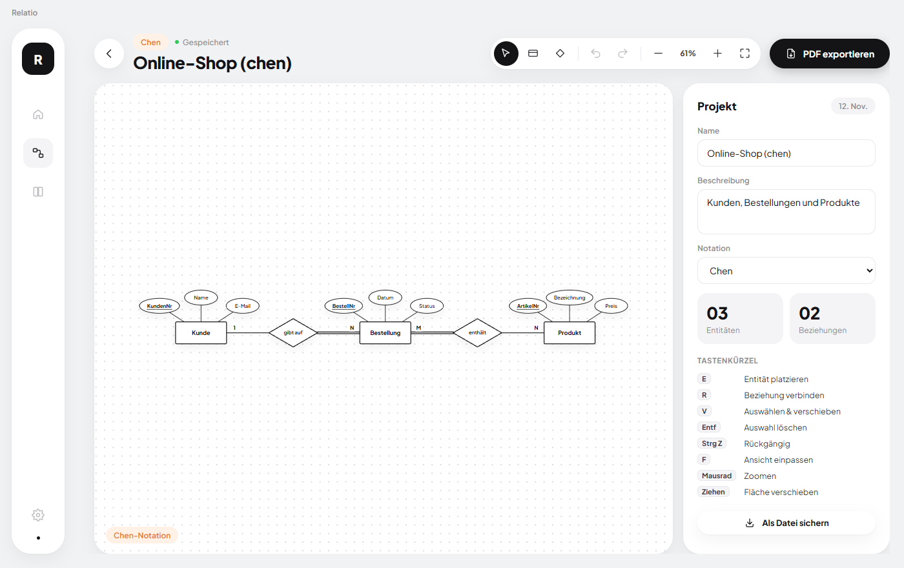
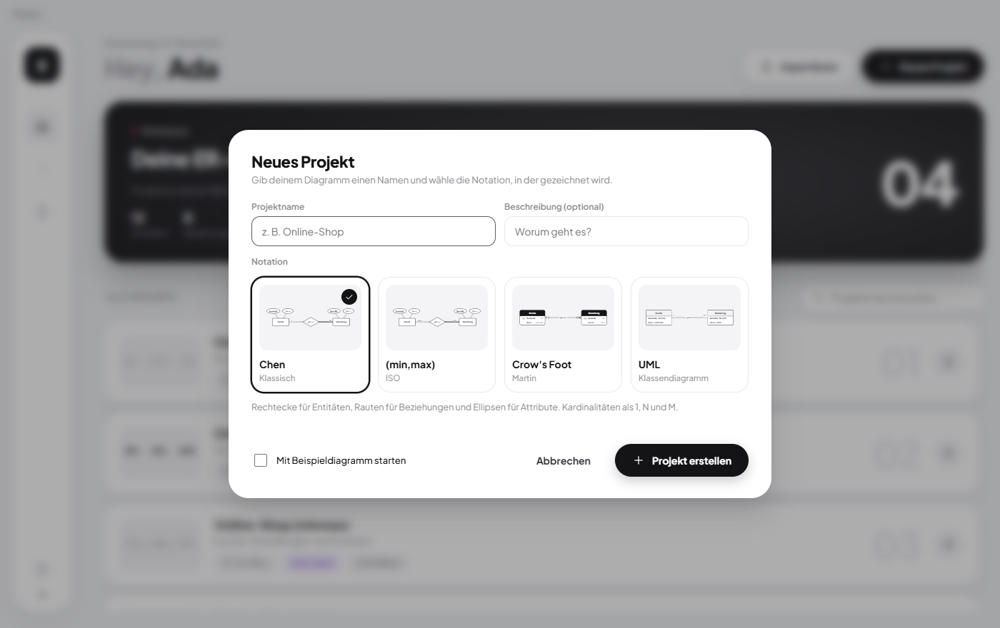

<p align="center">
  
</p>

<h1 align="center">Relatio</h1>

<p align="center">
  <b>Ein cleaner, leichtgewichtiger ER-Diagramm-Builder für Windows.</b><br/>
  Chen · (min,max) · Crow's Foot · UML — mit Vektor-PDF-Export.
</p>

<p align="center">
  <a href="https://github.com/noahzmm/relatio/releases/latest"><b>⬇ Download für Windows</b></a>
</p>

<p align="center">
  
</p>

## Features

- **Notation pro Projekt** – beim Anlegen wählst du zwischen **Chen**, **(min,max)**, **Crow's Foot** und **UML** (mit Live-Vorschau). Umschalten ist später jederzeit möglich, das Diagramm wird automatisch neu gezeichnet.
- **Schnell zeichnen** – Entitäten mit Doppelklick oder <kbd>E</kbd>, Beziehungen mit <kbd>R</kbd> und zwei Klicks, alles per Drag & Drop verschiebbar.
- **Attribute & Schlüssel** – Attribute mit Datentyp, Primärschlüssel per Klick; in Chen als Ellipsen (frei verschiebbar), in Crow's Foot/UML als Liste.
- **Kardinalitäten ohne Rätselraten** – Presets 1:1 · 1:N · N:M oder pro Ende „genau eine / keine oder eine / eine oder mehrere / beliebig viele“. Die Darstellung passt sich der Notation an (1/N/M, (0,n), Krähenfuß, 0..*).
- **Generalisierung (IS-A)** – mit <kbd>G</kbd> Obertyp und Untertypen verbinden, total/partiell und disjunkt/überlappend festlegen. Chen zeigt das IS-A-Dreieck, Crow's Foot/UML den Vererbungspfeil.
- **Tabellen-Ansicht** – mit <kbd>T</kbd> wird das Diagramm automatisch ins Relationenmodell übersetzt: Primär- und Fremdschlüssel, Verknüpfungstabellen für N:M, schwache Entitäten und drei Abbildungen für Generalisierungen (Tabelle je Typ, eine Tabelle, nur Untertypen).
- **SQL-Export** – `CREATE TABLE`-Skript für PostgreSQL, MySQL, SQLite oder SQL Server kopieren oder als `.sql` speichern.
- **PDF-Export** – gestochen scharfes Vektor-PDF in A4/A3 quer oder hoch oder exakt auf Diagrammgröße, optional mit Titelzeile – wahlweise mit Diagramm, Tabellen oder beidem.
- **Komfort** – Undo/Redo, Zoom & Pan, Raster-Ausrichtung, Auto-Speichern, Suche, Import/Export als `.relatio`-Datei, rekursive Beziehungen, schwache Entitäten.
- **Leichtgewichtig** – kein Framework, keine Cloud, kein Account. Vanilla JS + SVG, Projekte liegen lokal als JSON.

<p align="center">
  
</p>

<table>
  <tr>
    <td></td>
    <td></td>
  </tr>
</table>

## Installation

Lade im [neuesten Release](https://github.com/noahzmm/relatio/releases/latest) eine der beiden Dateien:

| Datei | Beschreibung |
| --- | --- |
| `Relatio-Setup-1.1.0.exe` | Installer mit Startmenü- und Desktop-Verknüpfung |
| `Relatio-1.1.0-portable.exe` | Ohne Installation starten, z. B. vom USB-Stick |

> Die Builds sind nicht signiert. Windows SmartScreen zeigt beim ersten Start einen Hinweis – über **Weitere Informationen → Trotzdem ausführen** startet die App.

## Tastenkürzel

| Taste | Aktion |
| --- | --- |
| <kbd>V</kbd> | Auswählen & verschieben |
| <kbd>E</kbd> / Doppelklick | Entität platzieren |
| <kbd>R</kbd> | Beziehung zwischen zwei Entitäten |
| <kbd>Entf</kbd> | Auswahl löschen |
| <kbd>Strg</kbd>+<kbd>Z</kbd> / <kbd>Strg</kbd>+<kbd>Y</kbd> | Rückgängig / Wiederholen |
| <kbd>F</kbd> | Ansicht einpassen |
| Mausrad / Ziehen | Zoomen / Fläche verschieben |

## Entwicklung

Voraussetzung: Node.js 22+ (20 funktioniert mit Warnungen).

```bash
npm install
npm start          # App starten
npm run smoke      # Smoke-Test: Screenshots + PDFs nach smoke-output/
npm run dist       # Installer + portable .exe nach dist/
```

```
main.js              Electron-Hauptprozess: Fenster, Speichern, PDF-Druck
preload.js           sichere Brücke (window.api)
renderer/
  index.html         App-Shell
  export.html        Seitenlayout für den PDF-Export
  styles.css         Design
  js/render.js       Layout & SVG-Rendering aller Notationen
  js/notations.js    Notationen, Kardinalitäten, Beispieldiagramm
  js/app.js          Übersicht, Editor, Dialoge, Einstellungen
```

Projekte werden unter `%APPDATA%\relatio\projects` gespeichert.

## Lizenz

[MIT](LICENSE)
